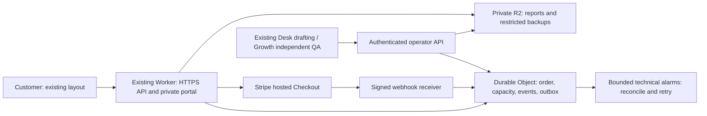

# Workflow Blueprint: terms and hosting review packet

**DRAFT FOR OWNER REVIEW — 20 October 2026. Not published policy or launch approval.**

Keep the approved preview layout. The product remains one $149 USD written
Workflow Blueprint. This packet proposes customer wording and a production
design; it does not activate checkout, change the current website, create
resources/credentials, amend jobs or approve spending. The overall business
budget remains the **existing owner-approved aggregate monthly limit**; no
increase is approved. Exact internal limits/headroom belong in the owned private
review copy and operations ledger. This is a business and engineering proposal,
not a legal compliance guarantee.

## 1. Decisions before setup or publication

| Decision | Recommended choice | Still requires an explicit decision |
| --- | --- | --- |
| Offer | One administrative quote-request, leasing-inquiry or shared-inbox workflow; $149 once, quantity one; existing deliverables/exclusions | Approve consistent name and the order-specific scope/terms shown before payment |
| Refunds | Full refund before first delivery; full refund if agreed scope cannot be fulfilled; customer chooses correction or refund for a material mismatch reported within seven days | Approve the complete wording below, including response and processing targets; no deduction of merchant fees |
| Delivery | Exact feasible date, proposed deadline 5 p.m. America/Denver, displayed before checkout and retained in the order | Approve the deadline convention; verify real capacity and existing obligations. Five business days is conditional, not an unconditional promise |
| Tax | Show $149 base, applicable tax and final total before payment | Determine jurisdictions/registrations, tax code and calculation method. Do not infer exemption from the fake zero-tax preview or enable a paid tax product by default |
| Retention | Unpaid content: 30 days after last activity and confirmed closure; paid content: 90 days after the later of revision-window closure and final delivery; empty sessions: seven days; restricted backups: up to 30 further days | Approve these periods, processor retention and deletion/restore behavior. They are recommendations, not statutory requirements or active settings |
| Minimal records | Keep necessary accounting/payment references and hashed replay controls separately; proposed seven-year accounting window | Accountant/owner must confirm the actual period and fields. No indefinite content retention disguised as accounting |
| Processors | Cloudflare for hosting/storage/access; Stripe for hosted payment; existing business email for requested support; reuse the existing authorized AI workspace if it can be securely connected | Confirm the exact AI provider/product, data terms, locations, training controls and any Google Workspace/Drive copies. The marked processor slot below blocks publication and real-brief collection |
| Budget/setup | Expected incremental Cloudflare base: $0 if an adequate Paid plan already exists, otherwise $5/month; proposed $10/month incremental review threshold, within the existing aggregate cap | Verify existing subscriptions, shared allowance usage and remaining headroom privately first. $10 is a proposed threshold, not approved spend or a provider-enforced hard cap |

The customer drafts in sections 2–3 assume approval of these recommendations.
The processor marker must be replaced with verified facts. Approval to prepare
this packet does not accept its material terms.

## 2. Proposed customer-facing order and refund wording

### Workflow Blueprint — $149 USD, one time

Your Workflow Blueprint covers one administrative workflow agreed in your order:
a quote-request, leasing-inquiry or shared administrative-inbox process. You
receive a workflow map, capture fields and routing rules, three editable
templates, setup instructions and tests, plus one clarification revision
requested within seven days of first delivery.

This is a written plan. It does not include installation, access to your
accounts, ongoing monitoring, emergency dispatch, regulated advice or decisions,
or unlimited support. Please do not send passwords, API keys, payment-card
details, sensitive personal records or information you are not authorized to
share. We may decline or ask you to clarify an unsupported request before payment.

Before payment, we show the agreed workflow, exact delivery date and timezone,
$149 base price, any applicable tax, final total and these terms. Your order
confirmation keeps that same scope, total and date. We do not move an agreed
date without your acceptance. No Kavik Works account or sales call is required;
Stripe may request your email and billing details during hosted checkout.

For this purchase, your accepted order and these Workflow Blueprint terms take
precedence over inconsistent general service terms about scope, timing,
cancellation and refunds. Other general terms continue to apply.

### Delivery and the included clarification

Your order shows the date we can support with current production and review
capacity. A five-business-day date is offered only when that capacity is
available. First delivery means the reviewed written report has been released
to your private order page and its availability has been checked. A payment
receipt, unfinished draft or unreviewed report does not count as delivery.

You may request one in-scope clarification through your private order page or
by emailing josh@kavikworks.com within seven days of first delivery. Your order
page shows the exact request deadline and timezone. The revision clarifies the
agreed written plan; it does not add implementation or another workflow. We
confirm a feasible revision date before committing to it. Your delivered report
remains available while a revision is prepared and reviewed.

### Cancellation before first delivery

If we receive your cancellation before first delivery, we will give you a full
refund of the amount paid, including any tax collected. Work already started
does not reduce that refund. Use the cancellation option on your private order
page or email josh@kavikworks.com with your order reference. Do not send card
details or your private recovery code. Receipt of the request, rather than the
time we later review it, determines whether it preceded delivery.

### If we cannot fulfil the agreed scope or date

If the request cannot be fulfilled within the agreed scope, we will offer a
full refund rather than require an additional purchase. If we cannot meet the
agreed delivery date, you may choose a new date that you accept or a full refund.
We will not silently extend the date. A late or uncertain payment does not
automatically create a promise against availability that has already expired.

### If delivered work materially misses the agreed brief

Contact us within seven days of first delivery and identify what materially
differs from the agreed brief. You may request correction or a full refund.
You do not have to use the clarification revision or accept a correction before
requesting a refund. We may ask for enough information to identify the order and
problem. A timely unresolved complaint remains open after the seven-day window;
the deadline is for reporting it, not for completing our response.

### Request handling and refunds

We aim to acknowledge and determine a routine request within two business days.
If we need more information or payment-provider investigation, we explain what
is missing and give you the next review date. We aim to submit an approved
refund within two business days of approval. Refunds go to the original payment
method; the provider and your financial institution determine when funds appear.
We do not deduct our processing fee from an approved full refund. We confirm
completion only after checking the provider's refund state, and will not issue a
duplicate refund while an earlier result is uncertain.

Please contact us about an unexpected charge so we can investigate. This does
not require you to waive rights available under applicable law or your payment
provider's dispute process. Nothing in this policy limits mandatory rights.
These terms concern this Workflow Blueprint only; other services have their own
agreed terms.

## 3. Proposed customer-facing privacy notice

**Editor-only launch gates:** the following is proposed customer text, conditional
on approval of section 1. Fill the processor and accounting-retention markers;
verify the no-training statement and actual email/Drive copies before collecting
real briefs. These unresolved facts prevent publication. Do not include this
editor note in the future published notice.

**Workflow Blueprint privacy notice — proposed effective date: set at launch.**

Robot Arms LLC, doing business as Kavik Works, provides this notice for the
Workflow Blueprint order service. Contact josh@kavikworks.com with privacy
questions or requests. This notice applies to the new order service, separately
from our email-only free workflow check.

### Information we use

We collect the workflow type, tools you describe, a short account of the
administrative handoff, scope confirmations, order references and any support
or clarification messages you send. We use them to decide whether the request
is supported, plan capacity, prepare and independently review your written
Blueprint, provide access, handle revisions/refunds and resolve problems.
Please use a business-level description without customer records or sensitive
personal information. You must be authorized to share the information provided.

Stripe collects payment and billing details on its hosted checkout, including
email and address details it requires. We do not receive full card numbers or
security codes. We retain the minimum payment status, amount, currency, tax,
provider references and receipt/contact information needed to fulfil and
reconcile your order. We do not use payment or support details to enrol you in
marketing without a separate choice.

The service uses essential session/security cookies and a private recovery
mechanism for access. Security and operational records may include IP address,
request time, route and error code. We keep brief/report content, payment-card
details and recovery credentials out of application logs. We do not add
advertising pixels, cross-site tracking or behavioural analytics to this order
flow. Stripe and other listed providers handle their own necessary security
processing under their policies.

### Service providers and AI assistance

Cloudflare hosts and protects the service and stores private order records and
files. Stripe processes payments and refunds. Customer-requested support email
uses **[[CONFIRMED BUSINESS EMAIL PROVIDER; INCLUDE DRIVE IF USED]]**.
AI-assisted drafting and separate
review use **[[AI PROCESSOR, EXACT PRODUCT, DATA TERMS AND PRIVACY LINK — OWNER
DECISION REQUIRED]]**.

We give providers only the information needed for their role. We do not sell
personal information or authorize customer content to be used to train AI
models. Providers may process information in countries other than your own;
we identify the actual providers and applicable arrangements before you submit
a brief. We may disclose information when legally required or necessary to
address fraud, security incidents, disputes or the enforcement of an agreement.

### Retention and deletion

Our ordinary retention periods are:

- Unpaid or abandoned briefs: 30 days after the last activity, once every
  associated payment attempt is confirmed closed and nonpayable.
- Paid briefs, reports and clarification content: 90 days after the later of
  the revision-request deadline and final delivery, once any requested revision,
  refund or dispute is resolved. Download a copy you wish to keep.
- Unused sessions: seven days. Application security logs: up to seven days.
- Restricted backups: up to 30 additional days after removal from active
  storage. If a backup is restored, recorded deletion requests are reapplied
  before normal access resumes.
- Necessary accounting/payment references and hashed replay-prevention records:
  **[[CONFIRMED RECORD-RETENTION PERIOD]]**, separately from brief/report content.

An unresolved payment, delivery, revision, dispute or legal preservation need
can require a limited hold. We retain only the information needed for that
purpose, restrict its use and review the hold. Provider-controlled payment,
email, AI and security records may have separate retention; the processor details
provided with this notice explain relevant limits.

### Your access, choices and security

Your private order page provides your report and available order actions. Keep
your recovery code private; possession can allow access. We do not put recovery
credentials in public links. You may contact josh@kavikworks.com to request
access, correction, deletion or a copy of your information. We verify requests
in proportion to their sensitivity without asking for passwords or full card
details. We explain when a required record or unresolved obligation prevents
immediate deletion. Rights and response requirements vary by location.

We use encrypted connections, restricted staff/service access and access
controls appropriate to each record. No system is perfectly secure. We respond
to incidents, restrict affected access and provide notices where required.
This is a business service, not a service directed to children. We publish
material changes with an effective date and explain changes affecting an
existing order; a later edit does not silently replace its agreed refund terms.

## 4. Reconciliation with current policy and implemented behaviour

Repository baseline checked: PR15 head `435a69719fea3e43fbd2cd34e0dbac1db20040d4`.
Public policy files still show 4 September 2026. No public file is edited here.
Read-only checks on 20 October confirm the live [refund](https://kavikworks.com/refunds),
[privacy](https://kavikworks.com/privacy) and [terms](https://kavikworks.com/terms)
pages retain these material provisions.

| Current evidence | Required reconciliation before launch |
| --- | --- |
| `refunds.html`: Blueprint material-failure window is seven days; Website Audit has a separate 48-hour category; delivered/accepted work is generally non-refundable; chargebacks without prior contact may terminate service | Give this Blueprint an explicit category: before-first-delivery cancellation, inability/late delivery, customer-selected correction/refund, no fee deduction. Do not borrow the Audit category or let the general exclusion override it. Reconcile the chargeback clause with the draft's preserved dispute rights; prior contact must not be a waiver condition |
| `terms.html`: no website payment; payment method confirmed in writing; only a signed SOW expressly overrides general terms; credential duties and 30-day termination language | Expressly recognize the accepted Blueprint order agreement and its product-specific precedence in the general terms before launch. Review online acceptance instead of assuming it satisfies the current signed-SOW clause. No credentials, implementation or 30-day cancellation restriction for this product; preserve other services' terms unless reviewed |
| `privacy.html`: email-only free check; broad analytics/cookie wording; generic processors and retention; no website payment | Keep the legacy free check's facts separate. Add the order-service notice and verify actual logs, cookies, payment collection, processors and retention. Do not claim all existing marketing pages have no analytics merely from this design |
| Preview: fake zero tax, simulated dates/payments/reviewer roles; no refund/cancellation API; bearer recovery; retention disabled; outbox is a separate harness | Refund copy, cancellation timestamps, late-date remedy, production identity, provider SDK and actual deletion still require implementation/testing. Mock flags are not launch evidence |
| Preview UI `preview/purchase/web/index.html`: older draft offers cancellation only before work begins and unsupported-scope refund before work | This packet supersedes that proposal for owner review, not for current customer use. The UI still displays test-only older copy; align it after terms approval. Layout approval did not approve those policy terms |
| Preview revision deadline is stored from first delivery; an unreviewed revision never replaces the published report | Preserve that behaviour. A material-mismatch remedy is separate from the one clarification; record unresolved remedies as retention holds |

## 5. Minimal Cloudflare production design — proposed, not provisioned

**Use the existing website Worker and domain, one SQLite-backed Durable Object
namespace, and one private R2 Standard bucket.** Add Access Free for operators
and Turnstile Free for admission abuse controls if approved. No D1, KV, Queues,
Workflows, container host, separate CRM, paid AI API, paid email service or new
business job is added by default. Keep Business Desk, Growth Studio and Owner
Brief and their schedules; Desk remains the sole business sender.

**Routing and private storage.** Preserve current marketing URLs and the exact
static-asset allowlist. Serve the same approved layout under a proposed
`/blueprint/` route family, with its APIs explicitly routed through the Worker;
never expose the repository root, test fixtures, operator files or database.
Private reports stream from R2 only after order authorization, with no public
bucket domain, default presigned bearer URL, CDN cache or indexing. Store the
minimal brief, order/terms version, dates, access hashes, capacity inventory,
payment references, events, cases and outbox in the Durable Object. Its single
business ledger serializes admission across all orders; customer authorization
is still checked on every read. [Worker routing](https://developers.cloudflare.com/workers/static-assets/routing/worker-script/)
and [SQLite storage](https://developers.cloudflare.com/durable-objects/api/sqlite-storage-api/).

**Capacity and Checkout.** In one ledger transaction, subtract paid obligations,
open payable invitations, active reservations, production, correction,
contingency, independent QA and revision effort. Offer only a feasible exact
date; unknown inventory, missing review/delivery tools or an incident blocks new
paid admission. Persist checkout intent before the external call. Use one opaque
order reference in Checkout metadata/client reference, the approved Price,
quantity one, USD, the verified tax treatment and immutable accepted terms/date.
Do not put the brief or personal data in metadata. Hold capacity while creation
is uncertain or a session remains payable/processing. Stripe permits a session
expiry 30 minutes–24 hours after creation; use a fresh 30-minute checkout lease
without silently extending retry invitations. [Checkout API](https://docs.stripe.com/api/checkout/sessions/create).

**Webhooks and durable reconciliation.** Verify raw bytes/signature using the
official SDK and the correct endpoint secret; bind to configured account,
environment and API/event version. Persist a deduplicated event before acknowledging
it; perform complex work through a durable outbox. Re-read authoritative Session,
line items and payment state, matching order, product, subtotal/tax/total,
currency, quantity and immutable payment identity. A success page or completed
event alone is not payment proof. Handle duplicate, reordered, missed and late
events; late paid obligations require a new accepted date or refund review.
[Webhook delivery](https://docs.stripe.com/webhooks).

Use Durable Object alarms for bounded technical retries/maintenance, not a new
marketing or sender schedule. Alarms can repeat; handlers must be idempotent.
Persist attempt limits, next time and unresolved incidents; exhausted retries
remain visible to Desk/Owner Brief. A receipt must have current nonpayable or
delivered/access readback before releasing capacity or asserting delivery.
[Alarms](https://developers.cloudflare.com/durable-objects/api/alarms/).
Stripe API-v1 idempotency keys may be pruned after 24 hours. Keep the local ledger
longer; never recreate an ambiguous operation with a new key or replay an old
creation after that window without authoritative reconciliation. If no reliable
provider ID/lookup exists, hold the operation for targeted investigation.
[Idempotency](https://docs.stripe.com/api/idempotent_requests).

**Operator access and fulfilment.** Access protects operator paths; the Worker
also validates JWT issuer/audience/expiry and role, so alternate hostnames cannot
bypass authorization. Approved service credentials separately identify Desk
drafting and Growth QA; a drafter cannot approve their own report. Existing jobs
claim and lease a case, write/read back its private artifact, record QA and
release only an approved version. Report access is customer-scoped; an old report
stays visible during revision. No routine founder approval is introduced.
[JWT validation](https://developers.cloudflare.com/cloudflare-one/access-controls/applications/http-apps/authorization-cookie/validating-json/)
and [service credentials](https://developers.cloudflare.com/cloudflare-one/access-controls/service-credentials/service-tokens/).
The actual native-job-to-HTTPS bridge and role-specific secret delivery are
**unverified launch blockers**; do not assume a Mac or current subscription can
provide them. If unavailable, hold admission and propose a concrete replacement
separately rather than silently add an AI API or fourth job.

**Retention, backups and observability.** Implement the approved periods across
ledger, R2 versions, outbox payloads, support/drafting copies and providers. Holds
override cleanup; preserve minimal replay records. Durable Object SQLite has
30-day point-in-time recovery, which must be reflected in deletion promises.
Propose daily encrypted application exports plus artifact manifests in a
restricted R2 backup prefix, expiring after 30 days. Restore into an isolated
namespace, reapply deletion/hold records and reconcile payments before reopening
admission. This same-account backup is not protection against total account
loss; accept that residual risk or separately approve an independent destination.
[Recovery](https://developers.cloudflare.com/durable-objects/api/sqlite-storage-api/).
Use redacted structured errors/metrics for oldest unresolved intent, stale
inventory, deadline risk, QA failures, webhook lag, deletion/backups and spend.
Never log bodies, cookies, authorization headers or recovery codes. Feed actionable
exceptions into the existing jobs' incident path; verify this bridge as well.
[Workers Logs](https://developers.cloudflare.com/workers/observability/logs/workers-logs/).

## 6. Costs, allowances and controls

Official public USD rates checked **20 October 2026**. They are not a quote for
the connected account; verify invoices, regional tax, account tier and usage.
Allowances are shared at account level, not reserved for this project.

| Item | Published allowance / rate | Incremental proposal |
| --- | --- | --- |
| Existing domain, static site, business email and AI workspace | Current subscriptions/charges not inspected here | Reuse; carry actual cost into the private aggregate budget ledger. Existing subscription does not imply API credits or a working job bridge |
| Workers Paid | $5/account/month minimum; includes 10m requests and 30m CPU-ms/month; excess $0.30/m requests and $0.02/m CPU-ms; ordinary static-asset requests free | $0 extra base if an adequate Paid plan is already active, otherwise $5/month. [Pricing](https://developers.cloudflare.com/workers/platform/pricing/) |
| Durable Object compute | Includes 1m requests and 400,000 GB-seconds/month; excess $0.15/m requests and $12.50/m GB-seconds | Avoid persistent connections and long waits; meter Worker and object use separately. [Pricing](https://developers.cloudflare.com/durable-objects/platform/pricing/) |
| Durable Object SQLite | Includes 25bn row reads, 50m row writes and 5 GB-month; excess $0.001/m reads, $1/m writes, $0.20/GB-month | Indexed bounded queries and small ledger; no extra database service. [Pricing](https://developers.cloudflare.com/durable-objects/platform/pricing/) |
| R2 Standard | 10 GB-month, 1m Class A and 10m Class B operations free monthly; then $0.015/GB-month, $4.50/m A, $0.36/m B; direct egress free | Private content/backups only; Standard, no paid custom domain or infrequent-access tier. [Pricing](https://developers.cloudflare.com/r2/pricing/) |
| Operator protection / admission challenge | Access Free for teams under 50 users; Turnstile Free | Confirm eligibility and actual seats; no paid upgrade. [Access](https://www.cloudflare.com/sase/products/access/), [Turnstile](https://developers.cloudflare.com/turnstile/plans/) |
| Workers Logs | Paid: 20m events/month included, then $0.60/m; seven-day retention | Redact and sample; reprice before the announced **1 December 2026** observability billing change. [Logs](https://developers.cloudflare.com/workers/observability/logs/workers-logs/) |
| Stripe | Standard US domestic cards: 2.9% + $0.30; original processing fees are not returned on ordinary card refunds | Illustrative $149 payment fee: **$4.62** after rounding. Actual account/payment method/tax/FX can differ. No paid Checkout custom domain, invoice add-on or Tax service by default. [Pricing](https://stripe.com/pricing) |

An illustrative, non-forecast monthly envelope—100,000 dynamic requests,
2m Worker CPU-ms, 100,000 object calls, 10,000 object GB-seconds, under 1 GB SQL,
2 GB R2, 10,000 A/100,000 B operations and 100,000 log events—fits the listed
allowances **if they remain available**. Cloudflare incremental cost would then
be $0 or the $5 base; this is not a guaranteed bill or an order-volume promise.
Ten illustrative $149 domestic-card payments add about $46.20 in Stripe fees,
or $51.20 with a new $5 base, before existing/other costs. This neither establishes
remaining budget headroom nor sets a fixed capacity cap or claims sales.

Before provisioning, reconcile actual existing monthly commitments and clarify
the cap's treatment of transaction fees/taxes; do not quietly exclude them from
an **overall** cap. Track refund liabilities/cash separately from earned revenue.
If headroom or paid-order funding is unknown, do not open new paid admission.
No budget increase or automatic plan upgrade is permitted.

Proposed controls: 8 KiB brief limit, 2 MiB/report and 10 MiB total files/order;
bounded versions, indexed queries, short outbound timeouts, five outbox attempts,
no permanent polling loops/WebSockets, verified Turnstile before expensive intake,
per-session/IP limits and global creation budgets. Retain public-webhook signature
verification instead of applying customer CSRF/challenges to Stripe. Set and test
a Worker CPU ceiling (initial target 100 ms/API request), an admission kill switch,
usage alerts and a proposed $10 incremental Cloudflare review threshold.
[CPU limits](https://developers.cloudflare.com/workers/platform/limits/).
Alerts/application throttles are **not a verified account hard spending cap**:
rejected traffic, storage, billing delays and existing services can still cost
money. Preserve webhook/reconciliation, private access and existing obligations
when stopping new admission. Verify monitoring and reserve headroom before setup.

## 7. Port and acceptance effort

The Python `http.server`, process-local operator sessions, filesystem secrets and
`sqlite3` transactions cannot be deployed unchanged as a Worker. Python Workers
run through Pyodide/WebAssembly and a Worker entrypoint; Python support is not a
persistent Mac server/filesystem. Recommend a small TypeScript Worker/SQLite
Durable Object port for the HTTP/storage/payment boundary, retaining the layout
and using the Python tests as behavioural reference. No container host is needed.
[Python runtime](https://developers.cloudflare.com/workers/languages/python/how-python-workers-work/).

Port admission SQL/uniqueness/migrations into object transactions, keep external
calls outside those transactions, replace fake signatures with the official SDK,
bind real account/environment/version, and implement actual refund/cancellation,
access rotation, hold-aware deletion, report storage and role verification. The
separate outbox harness is a test specification, not an already-connected adapter.

Planning estimate: **7–10 focused engineering days**, excluding access waits and
owner/accountant decisions: 2–3 for runtime/storage/authentication; 2–3 for
Checkout/webhook/outbox/refund; 2–3 for job/artifact/retention/restore integration;
one for end-to-end readiness evidence. This is an estimate, not a customer
delivery promise or authorization for billable work.

Acceptance must reproduce the 95 existing local contracts where applicable,
then add Cloudflare-local runtime/concurrency tests, signed provider fixtures,
cross-customer/role/alternate-host denials, cancellation-versus-delivery races,
lost-response and idempotency-window reconciliation, exact tax/amount matching,
paid/processing expiry holds, duplicate/refund events, late payment, independent
QA/revision access, retained complaints, backup restore/deletion replay and abuse
budgets. Test actual cloud job pickup, distinct reviewer identity and recipient
readback with synthetic data. Existing mocks prove neither cloud capability nor
provider behaviour.

## 8. Small isolated Stripe sandbox test and minimum permissions

The last supported account listing exposed live accounts only; an authorized
sandbox has not been established. Prefer an **existing, owner-selected general
sandbox** isolated from live settings. Do not create an anonymous sandbox, new
account or credential because documentation suggests it. [Isolation](https://docs.stripe.com/sandboxes).

Proposed bounded test: at most **six synthetic Checkout Sessions, two test
refunds, one temporary sandbox event destination and 100 API requests**, no real
customer/card/bank information, no live-mode read/write. Use approved restricted
sandbox credentials already held by the owner; if absent, ask the owner to issue
them through the provider and store values directly in the approved secret
store. Never put key/signing-secret values in files, PRs, logs or chat.

| Principal | Proposed minimum task access |
| --- | --- |
| Runtime sandbox key | Checkout Sessions create/read/expire; read the selected existing Price/Product and associated PaymentIntent/payment evidence. Deny payouts, transfers, balances, subscriptions, account settings and unrelated customer data |
| Refund-test credential | Separate temporary permission for test refund create/read and only required payment/charge read dependencies; no production refund authority |
| Setup operator | Owner handles any fixture Price/Product and single event-destination setup; runtime does not need webhook-management or unrestricted account permissions |
| Event receiver | Only the sandbox endpoint signing secret plus configured sandbox/account identity; no API key in browser |

These are the proposed resource/action requirements, not a claim that the
Dashboard supports object-level scoping or these exact permission labels. Verify
the current resource/dependency controls with a zero-permission restricted key,
add only documented dependencies, and stop on an unsupported minimum instead of
granting an unrestricted key. Sandbox isolation limits the accessible data.
[Restricted keys](https://docs.stripe.com/keys/restricted-api-keys).

Test ordinary paid checkout without browser return, failed/abandoned/expired
checkout, duplicate/reordered signed events, processing/late success where
supported, exact account/amount/tax/order mismatch rejection, one full test
refund and repeated uncertain refund reconciliation. Request only the needed
Checkout completion/async success/async failure/expiry and relevant refund events.
The endpoint is either an explicitly approved isolated staging Worker or an
approved temporary local forwarding tool; neither exists by implication.
Record sanitized IDs/results privately, disable/remove the temporary destination
and revoke test-only credentials when the approved test ends. Do not mutate live
objects or apply live configuration as cleanup.

## 9. Smallest next approval bundle

**First, decisions:** approve/amend section 2's refund/date terms; confirm exact
processors and data terms; choose retention/accounting periods; resolve tax;
verify existing costs and budget headroom. Do not treat these choices as an
instruction to publish or provision.

**Then, one explicitly bounded staging setup decision:** name the existing
Cloudflare account and isolated Stripe sandbox privately; authorize one staging
Worker, one SQLite Durable Object namespace and one private R2 bucket using the
existing domain/account, plus narrowly scoped Access/Turnstile configuration and
the six-session/two-refund test above. Approve the owner-supplied restricted
credentials and endpoint secret through secure entry only. **Default: reuse an
already active Workers Paid plan.** If none exists, a separate, explicit selection
of the **$5/month Workers Paid upgrade** is required, subject to privately verified
budget headroom; do not interpret a general staging approval as that selection.
A new sandbox/credential likewise requires a separately named decision. Use the
proposed $10 incremental review threshold, not a claim of a hard cap.
If access, pricing or least-privilege support differs, prepare the concrete change
before proceeding. Staging receives synthetic data. Access must restrict its
entire UI and customer/operator APIs to approved test principals; exempt only the
signature-verified sandbox webhook receiver. Verify alternate hostnames cannot
bypass those restrictions. No public customer intake is activated.

**Finally, a separate production decision after evidence:** approve exact
production resources/permissions, any real refund authority, native job bridge
and minimal prompt changes, general-term precedence and public policy text, customer routes and checkout
activation. Require independent review, passing sandbox/restore/capacity/access
checks and verified budget/processor facts. No current approval includes merge,
production deployment, customer data, live charges/refunds, schedule changes or
general access expansion. Until then, preserve the existing site, offer and jobs.
